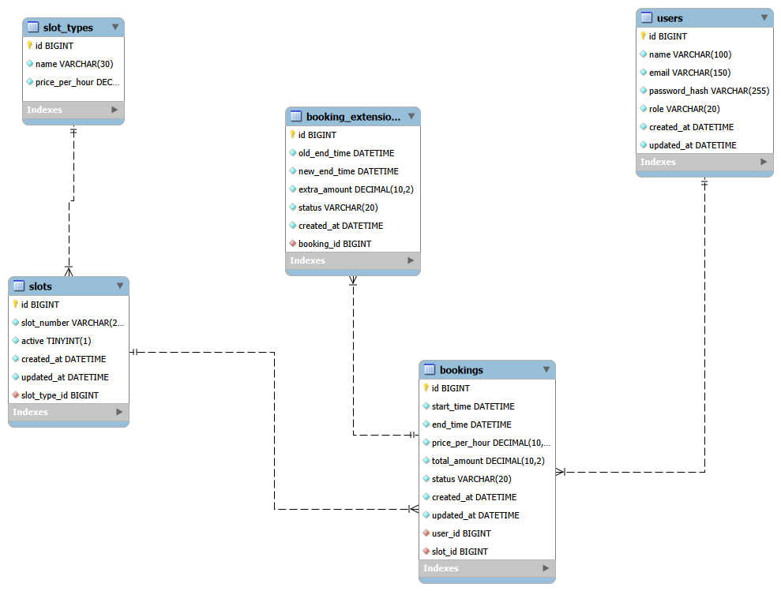

# Smart Parking Slot Reservation System

A Spring Boot backend for reserving parking slots in a single parking facility. Drivers book a slot for a time range, extend it, or cancel it, and the owner manages slots and confirms bookings. The main focus is **preventing double booking** when many users book at the same time.

## Tech stack

- Java 25, Spring Boot 4
- Spring Security with JWT authentication and role-based access (USER, ADMIN)
- Spring Data JPA (Hibernate), MySQL 8
- Flyway for versioned database migrations
- Spring Scheduler for automatic expiry
- Maven

## Features

- Register and log in with JWT (BCrypt-hashed passwords)
- Admin creates slot types (for example CAR, BIKE) with hourly prices, and creates slots
- Search free slots for a date and time range
- Book a slot for a time range; the price is calculated from the slot type
- Cancel a booking (only the owner can cancel)
- Extend a confirmed booking in whole hours, if the slot is free for the extra time
- Unpaid bookings and extensions expire automatically after a set time
- Consistent error responses with proper HTTP status codes (400, 401, 403, 404, 409)

## ER diagram



Tables: `users`, `slot_types`, `slots`, `bookings`, `booking_extensions`.

## Design decisions

- **No double booking:** the slot row is locked with pessimistic locking (`SELECT ... FOR UPDATE`) before the overlap check, so two simultaneous requests for the same slot are handled one after the other.
- **Overlap rule:** two bookings overlap when `existing.start < new.end AND existing.end > new.start`. A booking that starts exactly when another ends is allowed.
- **Price snapshot:** each booking stores the hourly price at the time of booking, so later price changes do not alter old bookings.
- **Extensions are separate records:** a booking's end time changes only after its extension is confirmed, which keeps an audit trail.
- **Database schema is versioned with Flyway,** and Hibernate only validates it.
- **Object-level authorization:** users can only see, cancel, or extend their own bookings.
- **No secrets in the code:** the database password and JWT secret come from environment variables.

## API overview

| Method | Endpoint | Access | Purpose |
|---|---|---|---|
| POST | `/api/auth/register` | Public | Register |
| POST | `/api/auth/login` | Public | Log in, get a JWT |
| GET | `/api/users/me` | Logged in | Own profile |
| GET | `/api/slot-types` | Logged in | List slot types |
| GET | `/api/slots` | Logged in | List slots |
| GET | `/api/slots/available?start=&end=&slotTypeId=` | Logged in | Free slots for a time range |
| POST | `/api/bookings` | Logged in | Create a booking (starts as PENDING) |
| GET | `/api/bookings/my` | Logged in | Own bookings |
| PATCH | `/api/bookings/{id}/cancel` | Owner | Cancel a booking |
| POST | `/api/bookings/{id}/extensions` | Owner | Request an extension |
| POST | `/api/admin/slot-types` | Admin | Create a slot type |
| POST | `/api/admin/slots` | Admin | Create a slot |
| PATCH | `/api/admin/slots/{id}/status` | Admin | Activate or deactivate a slot |
| POST | `/api/admin/bookings/{id}/confirm` | Admin | Confirm a booking (temporary, until payments) |
| POST | `/api/admin/extensions/{id}/confirm` | Admin | Confirm an extension (temporary, until payments) |

## Run locally

1. Install Java 25 and MySQL 8.
2. Create the database:
   ```sql
   CREATE DATABASE smart_parking CHARACTER SET utf8mb4;
   ```
3. Set two environment variables (the JWT secret should be at least 32 characters):
   ```
   DB_PASSWORD=your_mysql_password
   JWT_SECRET=your_long_random_secret
   ```
4. Start the application:
   ```
   ./mvnw spring-boot:run
   ```
   Flyway creates all tables on the first start. The API runs on `http://localhost:8080`.

## Project status

- Done: authentication, slot management, availability search, booking with locking, cancellation, extension, automatic expiry
- Planned: unit tests (JUnit and Mockito), Swagger API documentation, online payment integration